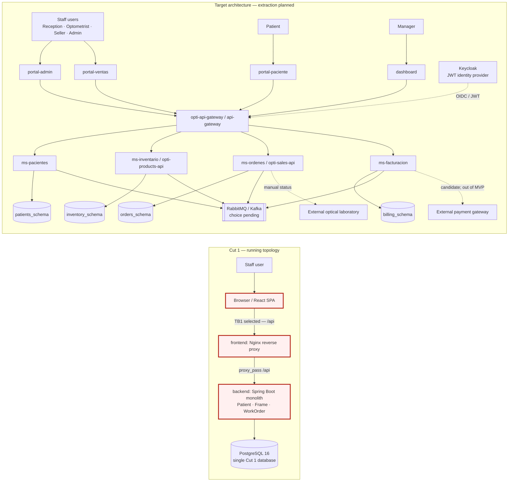

# Attack surface map — OptiView

Author: @DaniKaizenNetwork · Group G2 · 2026-10-29

## Scope and runtime status

This map separates the Cut 1 runtime from the target microservice architecture. The selected boundary is **TB1: browser client → Nginx `/api/` proxy → Spring Boot backend** in Cut 1. The gateway, Keycloak, extracted services, broker, and external payment integration are shown as target/planned components where the team documents them that way.

## Trust boundaries

| ID | Boundary | Status | Main control documented today |
|---|---|---|---|
| **TB1** | Browser / public client → Nginx `/api/` proxy → Spring Boot backend | **Selected for this analysis** | Cut 1 JWT filter; `/api/**` requires authentication; write routes apply role checks. |
| TB2 | Backend → PostgreSQL | Cut 1 runtime | Backend owns database access; the client does not connect directly. |
| TB3 | `opti-api-gateway` → domain APIs | Target and active team threat-model claims exist | JWT validation and service authorization are documented for the target architecture. |
| TB4 | Domain services → event broker | Target; broker product is undecided | Event envelope includes `eventId`; consumers are expected to be idempotent. |
| TB5 | Orders/Billing → external laboratory/payment provider | External/target; live payment provider is out of MVP | Laboratory status is currently manual; payment gateway is only a candidate integration. |

## Asset inventory

| Asset | Where it lives or crosses | Classification | Reason |
|---|---|---|---|
| User credentials and access JWT | `POST /api/auth/login`, browser, backend auth flow | Restricted | Credentials or tokens can enable impersonation. |
| Patient identity and contact data | `Patient` aggregate and Cut 1 PostgreSQL | Restricted | Identifies a patient and is personal information. |
| Optical prescription and clinical history | Patients context / `patients_schema` in target | Restricted | Clinical information requires strict access. |
| Frame SKU, price, and stock | `Frame` aggregate and inventory data | Confidential | Business inventory and pricing data. |
| Work order and patient association | `WorkOrder` aggregate and orders data | Confidential | Links a patient to purchased products and order history. |
| Invoice and payment references | Billing context / `billing_schema` in target | Restricted | Financial records and payment references. |

## Entry points for TB1

| Entry point | Caller | Authentication/authorization in Cut 1 |
|---|---|---|
| `POST /api/auth/login` | Browser user | Public; username and password are checked by `AuthenticateUseCase`. |
| `GET /api/patients` | Staff browser | Valid JWT required. |
| `POST /api/patients` | Staff browser | JWT with `ADMIN`, `SELLER`, or `OPTOMETRIST`. |
| `POST /api/frames` | Staff browser | JWT with `ADMIN`. |
| `POST /api/work-orders` | Staff browser | JWT with `ADMIN` or `SELLER`; request carries `patientId` and `frameId`. |

Implementation references in this team documentation checkout: `05-release/optiview-platform-v1.0.0/frontend/nginx.conf`, backend `SecurityConfig`, `AuthController`, and `WorkOrderController`; architecture references: `05-architecture/overview.md`, `05-architecture/deployment.md`, and `07-api/authentication.md`.

> Reflection entry CP1 belongs in the student's reflection document and must be written by the student.

